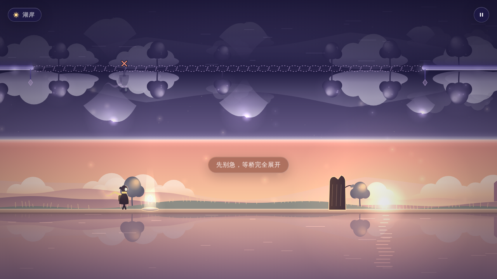
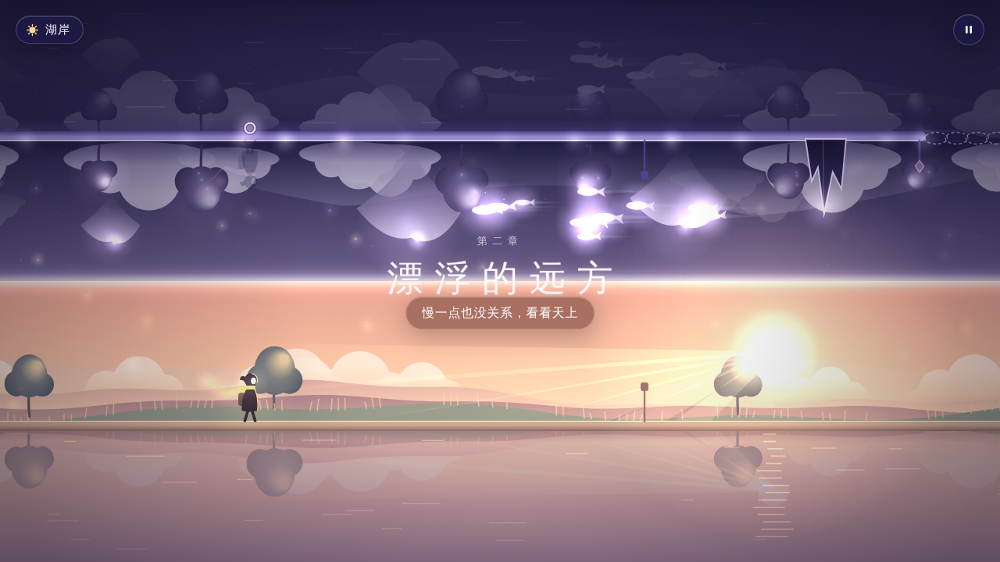

# 倒影之间 · Between Reflections

> 一次按键，走进湖面的另一场梦。
> Game Off 2026 参赛作品 · 主题 SHIFT

一段在现实湖畔与倒置梦境之间穿行的短途旅行。旅人自动向前走，玩家按 **Shift** 在两个世界之间瞬间切换：踩过发光石板，另一个世界里带同样记号的桥会展开，桥变成实线后再切换过去。


| 黄昏的湖岸 | 天上的鱼群 |
| --- | --- |
|  |  |

## 怎么玩

| 操作 | 作用 |
| --- | --- |
| `Shift`（左右均可）/ `空格` / 点击画面 | 瞬间走到另一个世界（每次新按下切换一次，按住不连发） |
| `R` | 回到最近的检查点 |
| `Esc` | 暂停 / 继续（浏览器失去焦点时也会自动暂停） |

- 人物下方（或上方）的小记号表示**另一边此刻能不能站**：圆圈是安全，叉号是危险。
- 桥有三种状态：虚线（未触发）、逐片出现（展开中）、实线并亮起记号（可以走）。
- 检查点只在本次游玩中有效，刷新页面会回到标题。

## 运行

不需要安装任何东西：**双击 `index.html`** 就能在浏览器里玩（推荐 Chrome / Safari / Edge）。

## 上传到 itch.io

1. 把本文件夹里的内容（`index.html`、`css/`、`js/`）压缩成 zip（`index.html` 要在 zip 的最外层），或直接用上一级目录里的 `倒影之间-itch.zip`。
2. itch.io 新建项目，Kind of project 选 **HTML**，上传 zip，勾选 “This file will be played in the browser”。
3. Embed options 建议 1280 × 720，勾选 “Mobile friendly” 与 “Fullscreen button”。

整个游戏约 120 KB，没有外部依赖。

## 美术方向（v0.2 重构）

- **氛围**：低垂的金色阳光、丁达尔光束、空气透视的远山、地平线云海；梦境是发光的云海、倒悬的光树、漂浮的岛、鱼群与星河。
- **光**：所有发光物体额外画进一张低分辨率“光层”，最后叠加放大，形成柔和的泛光；湖面实时倒映天空与树影，并有日月的光路。
- **角色**：披斗篷、背小包的旅人，一条随风飘动、会发光的长围巾。
- **界面**：系统字体、细字重大标题、毛玻璃面板、胶囊按钮、iOS 式开关，动效克制。
- 机器较慢时会自动关闭部分光效，保证流畅。

## 文件结构

```
index.html            页面与界面结构
css/style.css         界面样式（毛玻璃、胶囊按钮、开关）
js/config.js          全部可调参数（GDD 第 9 节）
js/util.js            数学、确定性随机、颜色工具
js/level.js           关卡数据：缺口、石板、桥、障碍、检查点、提示、章节、景观点
js/game.js            纯逻辑：状态机、通行判定、机关、检查点（不碰 DOM，通过事件通知界面）
js/audio.js           Web Audio 合成的音乐、环境声、混响与反馈音
js/ui.js              界面层：输入、面板、文字、声音挂接、缩放、主循环
js/gfx/fx.js          光层（泛光）、湖面倒影、坐标镜像
js/gfx/palette.js     配色：现实从午后到星夜，梦境三种氛围
js/gfx/scenery.js     远景：天空、日月、光束、山、云海、树、粒子、鱼群、星河、光轮
js/gfx/props.js       近景：道路、桥、光柱石板、障碍、灯盏、观景台
js/gfx/traveler.js    旅人
js/gfx/renderer.js    画面合成顺序
```

### 改关卡 / 改参数

- 想调手感：改 `js/config.js`（例如 `SPEED`、`BRIDGE_DEPLOY`）。改速度后请重新走通全部关卡。
- 想改关卡：在 `js/level.js` 里用 `hole / bridgeOver / plate / obstacle / cp / text` 增删机关，坐标单位是逻辑像素，速度 100 时 100 像素 = 1 秒。
- 网址后加 `?debug` 会在左下角显示当前坐标、世界与检查点，方便对照 GDD 填写关卡记录。

## 与 GDD v0.1 的对应

| GDD 内容 | 实现 |
| --- | --- |
| 自动前进、Shift 瞬间切换、梦境倒立 | ✓ 现实脚底 y=540，梦境脚底 y=180，以湖面镜像 |
| 双向石板开桥、形状标记、三种桥状态、提示线 | ✓ 圆环 / 叶片 / 菱形 / 星形四种记号 |
| 先切换再判定、连按不刷进度、失败与暂停不接收切换 | ✓ |
| 三章连续路线、8 个检查点、检查点预开桥 | ✓ 约 183 秒，18300 逻辑像素 |
| 六个景观点、按旅行进度换景、同地点保持一致 | ✓ 萤火、发光树冠、漂浮远山与云、鱼群、星河、月亮与光轮对齐 |
| 失误 0.6 秒淡出 + 1 秒准备，显示具体原因，连续同类失败给操作提示 | ✓ Shift / R 可跳过 |
| 暂停冻结桥计时与动画、失焦自动暂停 | ✓ |
| 声音开关（浏览器记住）、减少装饰动画选项 | ✓ |

与建议值略有出入的地方：全程必要切换 13 次（GDD 建议 8–12 次），首次试玩后可在 `level.js` 中删去一处换路调整。

## 素材与 AI 使用说明

- 画面：全部由代码实时绘制，没有使用图片素材。
- 声音：全部由 Web Audio 实时合成，没有使用音频文件。
- 字体：使用系统自带中文字体。
- 引擎 / 第三方代码：无。
- AI 使用：程序、图形与声音代码由 Claude（Anthropic）根据策划文档编写；玩法设计与策划文档由作者完成。提交 Game Off 时请按规则如实披露。
