# 倒影之间 · Between Reflections

> 按一下，天地在白昼与长夜之间翻转。
> Game Off 2026 参赛作品 · 主题 SHIFT

一位唐朝旅人（幞头、圆领袍、乌皮靴）从江南烟雨出发，经过宫苑园林、秋山湖泊、长城、雪山冰川，走到雪域圣湖。旅人自己向前走，按 **Shift** 让整个画面在白天和夜晚之间翻转，按 **空格** 跳。同一个地方，白天和夜里的路不一样。

v0.4 起全部改成像素风：画面内部是 320×180，放大 4 倍显示；背景是 `assets/bg` 里的像素画。每次出发，每一站的天气随机（晴、雨、雪、雾、风），旅人的衣服和动作跟着变：晴天手持书卷或一手背后，下雨撑油纸伞，下雪披红斗篷，起风袍角翻飞。

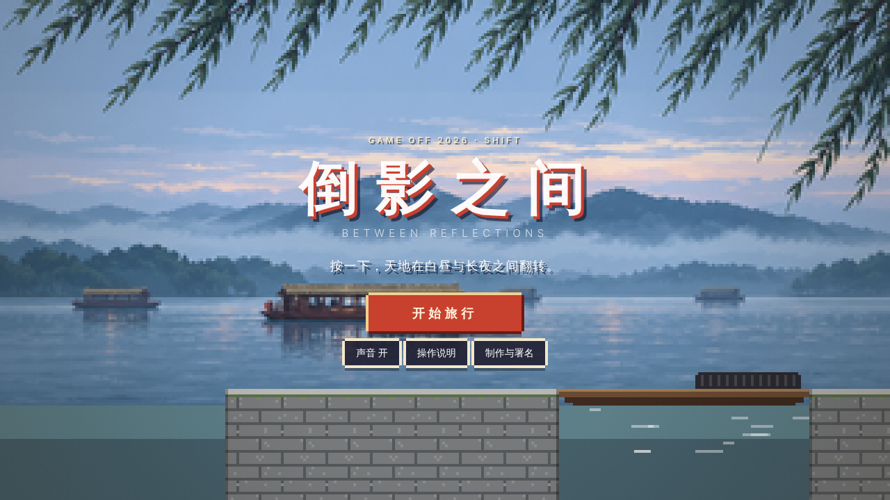

| 江南烟雨 · 雨 | 宫苑园林 · 雪 |
| --- | --- |
| 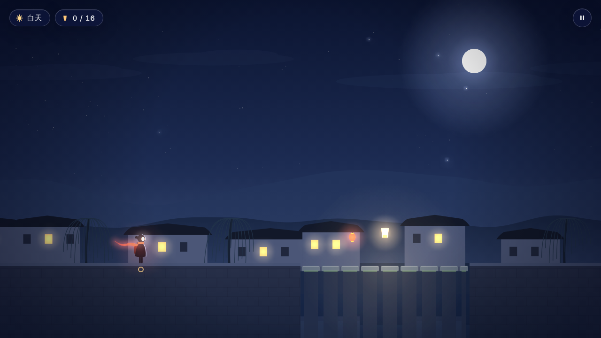 | 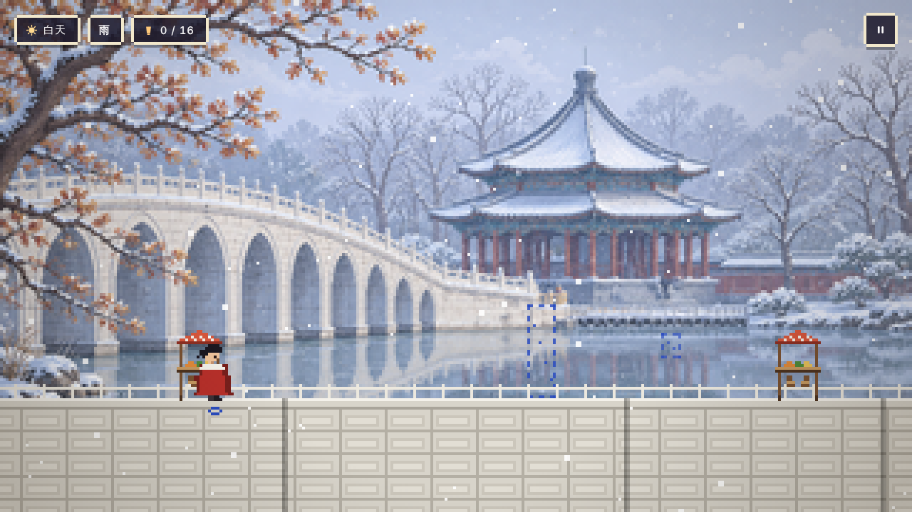 |
| **长城 · 夜** | **雪山冰川 · 雾** |
| 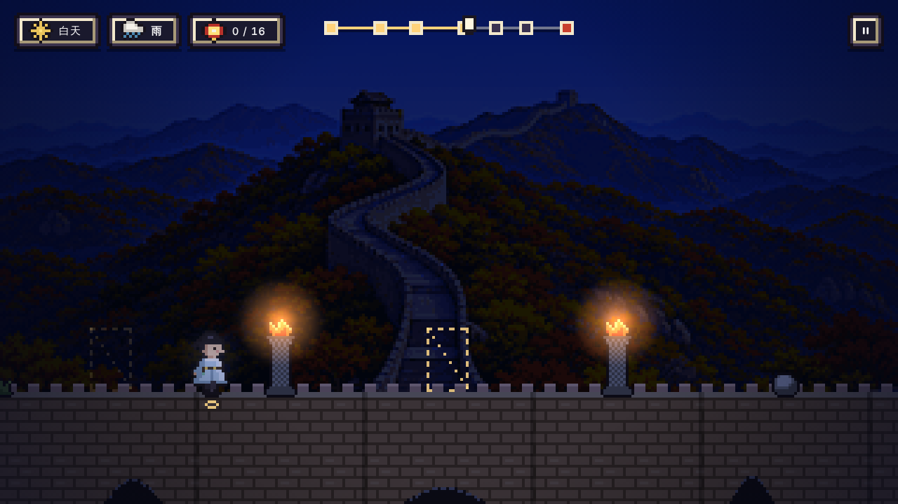 | 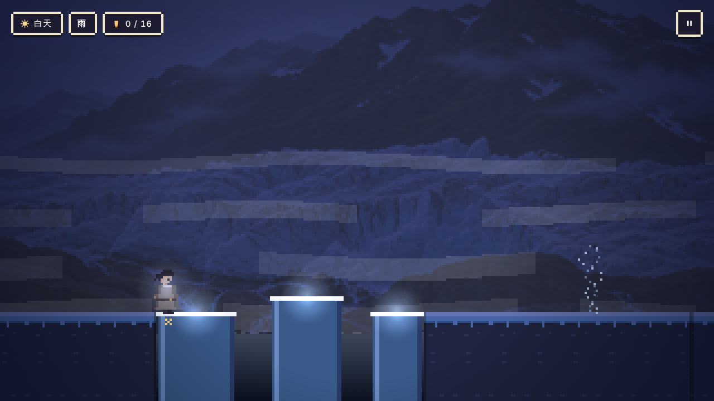 |

v0.5 打磨：背景重新取色变清晰；旅人重画（描边、明暗、8 帧奔跑、起跳 / 下落 / 落地 / 呼吸）；加了近景剪影、路边摆件、检查点石碑；落地扬尘、拾灯火星、失误震屏；踩拍连击与每站“甲乙丙丁”印章；像素边框界面与旅程进度条。

v0.6 精进（保留自动奔跑，借鉴节奏跑酷与精准平台游戏的机制，不抄内容）：
- **空中翻面借力**：跳起后在空中按 Shift，换面的同时再弹起一次（每次离地一次）。秋山、长城、圣湖各加了一段一跳够不着、必须借力的地方。
- **按键奏乐**：切换、跳、借力都会弹出当前和弦里的音；沿路的**引路铜钱**每半拍一枚，连续吃到会顺着五声音阶往上走。
- **乐器层**：音乐分四层（鼓与低音 → 和声 → 旋律 → 高音琶音），收灯、连续踩拍 4 次各加一层，失误掉一层。
- **美术**：水面倒影、草沿与雪檐（下雪的站整条路都会积雪）、地面越往下越暗、镜头上下平滑跟随、落地轻沉、切换光波边缘改成像素点溶解、物件跟着鼓点轻跳。

v0.7：江南的乌篷船改成**渡船**，停在岸边，人踩上去才开，船夫随着拍子撑篙，载人漂到对岸停下。新加一座低石拱桥：白天站在船上过不去，要切到夜里落潮，从桥洞下的石阶走过去，再跳起来切回白天落回船上（船会一直往前漂，等着你）。

| 渡船 | 低桥 |
| --- | --- |
| 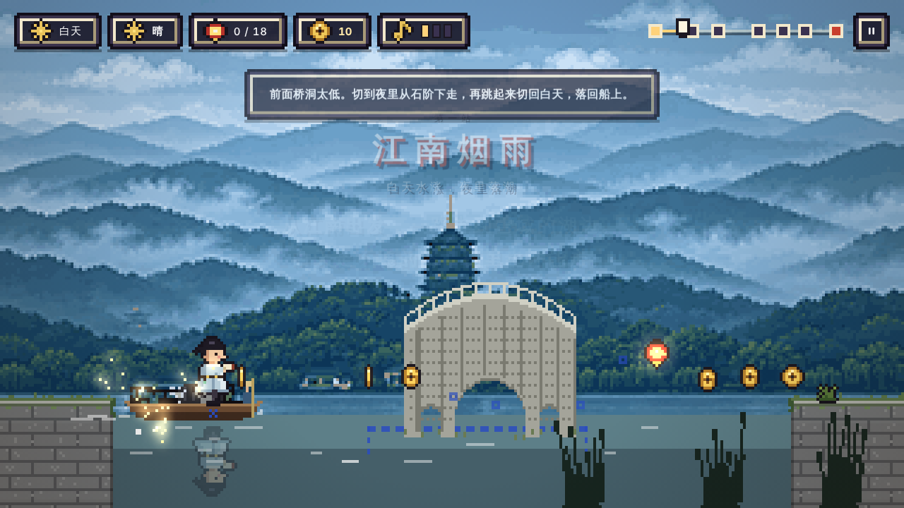 | 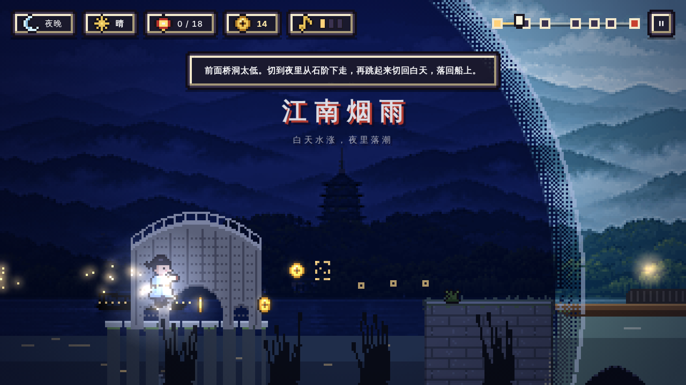 |

| 秋山 · 铜钱与草沿 | 水面倒影 |
| --- | --- |
| 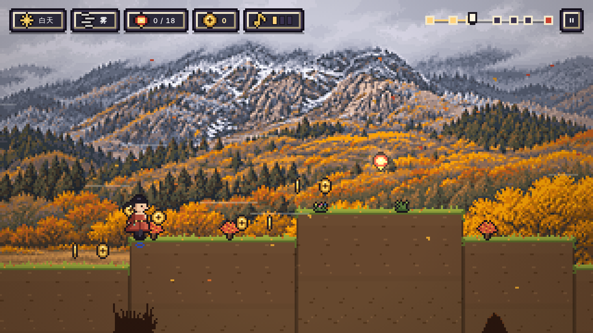 | 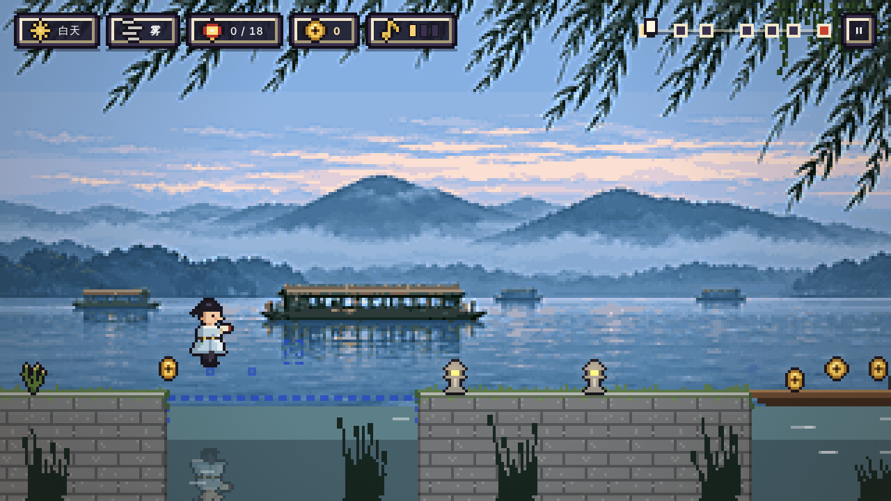 |

| 教学按键 | 踩拍连击与印章 |
| --- | --- |
| 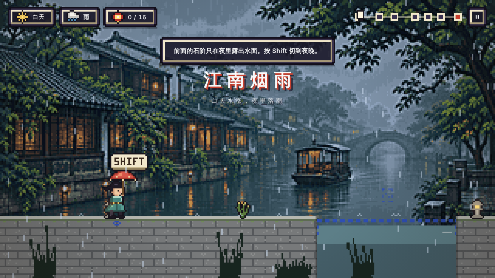 | 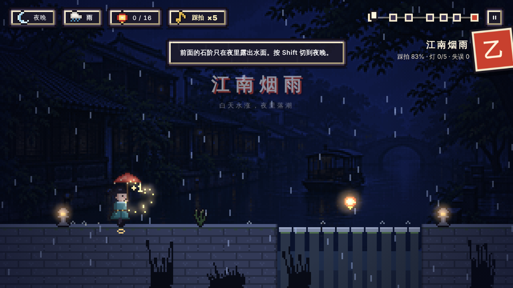 |

## 怎么玩

| 操作 | 作用 |
| --- | --- |
| `Shift` / 点击左半屏 | 白天与夜晚瞬间切换（整屏翻转） |
| `空格` / `↑` / `W` / 点击右半屏 | 跳 |
| 空中按 `Shift` | 翻面并借力再弹起一次 |
| `R` | 回到最近的检查点 |
| `Esc` | 暂停 / 继续（浏览器失去焦点时也会自动暂停） |

- 前方淡色的虚线轮廓是**另一面**的路和障碍：白天看到的是夜里的路（蓝色），夜里看到的是白天的路（金色）。
- 人物脚下的小圆圈表示另一面此刻能站，叉号表示不能。
- 音乐跟着路程打拍子，障碍落在鼓点上；踩着拍子切换，光波会更亮，还会多一个和弦。
- 沿途 16 盏灯可以收集，有的只在一面出现，终点会显示收集数、最长连拍、失误次数和用时。
- 连续踩在拍子上切换会累积“踩拍 ×N”。每走完一站，按踩拍率、收灯和失误盖一枚甲 / 乙 / 丙 / 丁的印章。

## 六个区域

| 区域 | 白天 | 夜晚 | 新东西 | 可能的天气 |
| --- | --- | --- | --- | --- |
| 江南烟雨 | 水涨，渡船浮起来，踩上去才开 | 落潮，石阶露出水面 | 切换、乘船、低桥 | 雨、雾、晴 |
| 宫苑园林 | 货摊挡路 | 宫门紧闭 | 铜铃开锁 | 晴、雪、雨 |
| 秋山湖泊 | 山石层层 | 萤火连成路 | 跳 | 晴、风、雪 |
| 长城 | 战鼓 | 烽火 | 跟着鼓点快速切换 | 晴、雪、风 |
| 雪山冰川 | 雪桥一踩就塌 | 看清真正的冰柱 | 幻影 | 晴、雾、雪 |
| 雪域圣湖 | 牦牛在湖边 | 湖面结冰可以走 | 全部组合 | 晴、雪 |

全程约 3 分 26 秒，12 个检查点。

## 素材

- `assets/bg/`：背景像素画，由 `tools/build_assets.py` 从“背景像素”文件夹里的 1280×720 图还原成原生 320×180。哪一站、哪种天气用哪几张图，写在 `js/gfx/regions.js` 开头。
- `assets/sprites.png`：旅人（7 套衣服 × 13 帧）、障碍、道具、路边摆件、石碑、按键图标，全部带 1 像素深色描边。
- `assets/ui/`：界面用的九宫格边框（frame / btn / paper）和像素图标。`sprites@4x-preview.png` 是放大 4 倍的预览。
- 想改人物或道具：改 `tools/build_assets.py` 里的像素定义后运行 `python3 tools/build_assets.py`；换背景：`python3 tools/build_assets.py ~/游戏/背景像素`。

## 运行

不需要安装任何东西：**双击 `index.html`** 就能在浏览器里玩（推荐 Chrome / Safari / Edge）。

调试：网址后加 `?debug` 显示坐标与拍子；加 `?at=3` 直接从第 3 个区域开始。

## 验证关卡

关卡改完后用 Node 跑一遍自动求解，确认每一段都能走通：

```
node test/solve.js .     # 从每个检查点出发分别求解
node test/run.js .       # 从头到尾连续通关一次
node tools/coins.js .    # 改完关卡后重新摆引路铜钱（生成 js/coins.js）
```

## 文件结构

```
index.html            页面与界面结构
css/style.css         界面样式（毛玻璃、胶囊按钮、开关）
js/config.js          全部可调参数：速度、节拍、跳跃、切换光波
js/util.js            数学、噪声、确定性随机、颜色工具
js/level.js           关卡：用“拍”为单位搭地面、障碍、铃与门、灯、检查点
js/coins.js           引路铜钱（tools/coins.js 生成）
js/game.js            纯逻辑：奔跑、跳跃、昼夜切换、碰撞、检查点（不碰 DOM）
js/audio.js           Web Audio：跟路程同步的五声音阶音乐与音效
js/ui.js              界面层：输入、面板、文字、缩放、主循环
js/gfx/fx.js          320×180 像素画布、光层、夜景调色
js/gfx/regions.js     背景挑图与昼夜、地面花纹、水面 / 深谷、天气粒子、近景剪影
js/atlas.js           图集坐标（脚本生成）
js/gfx/props.js       地面质感、障碍、铃铛、灯、雪桥、预告轮廓、路边摆件、检查点石碑
js/gfx/traveler.js    唐朝旅人：按天气选衣服与动作
js/gfx/particles.js   扬尘、火星、浮字、震屏
js/gfx/renderer.js    画面合成与整屏切换光波
test/                 自动求解与通关脚本
```

## 素材与 AI 使用说明

- 背景：像素画由作者提供（assets/bg）。
- 人物与道具：原创像素画，由 tools/build_assets.py 生成。
- 声音：全部由 Web Audio 实时合成，没有使用音频文件。
- 字体：使用系统自带中文字体。
- 引擎 / 第三方代码：无。
- AI 使用：程序、图形与声音代码由 Claude（Anthropic）编写；玩法方向与策划由作者完成。提交 Game Off 时请按规则如实披露。
